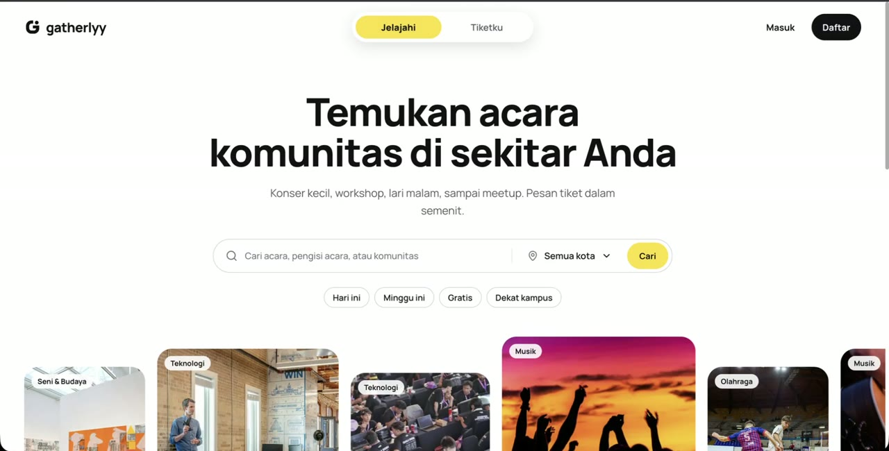
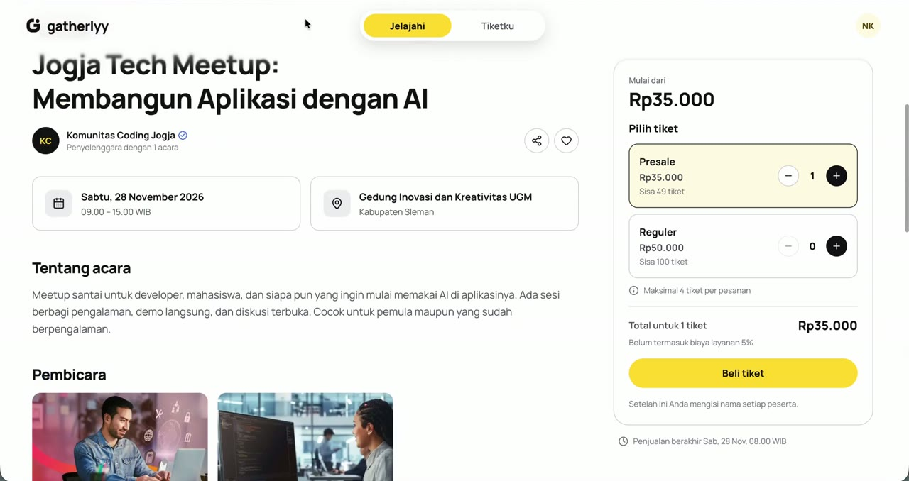
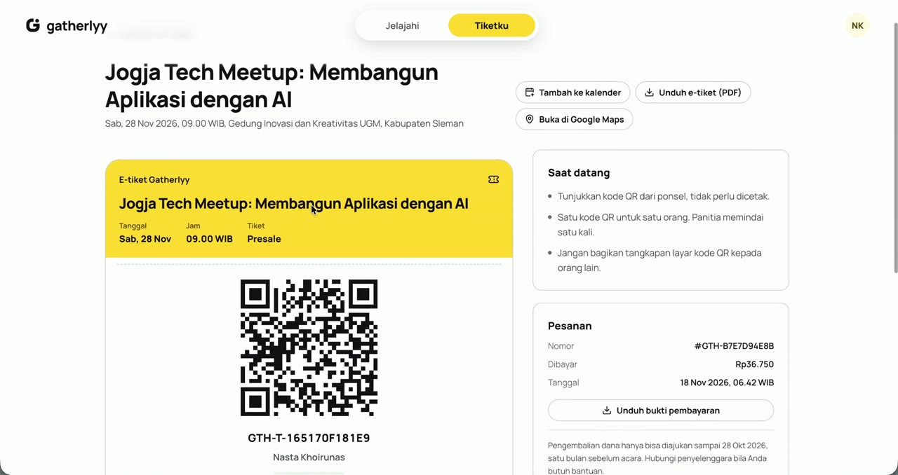
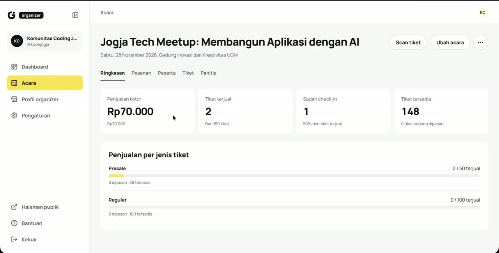
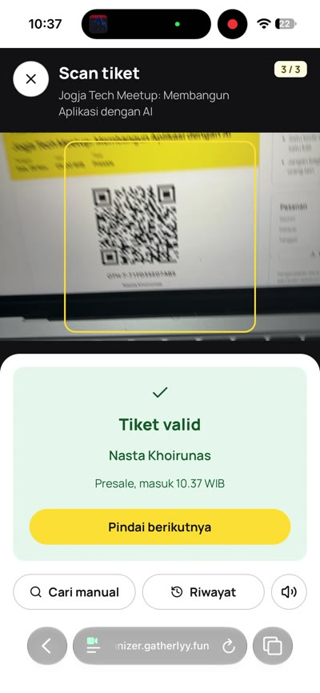
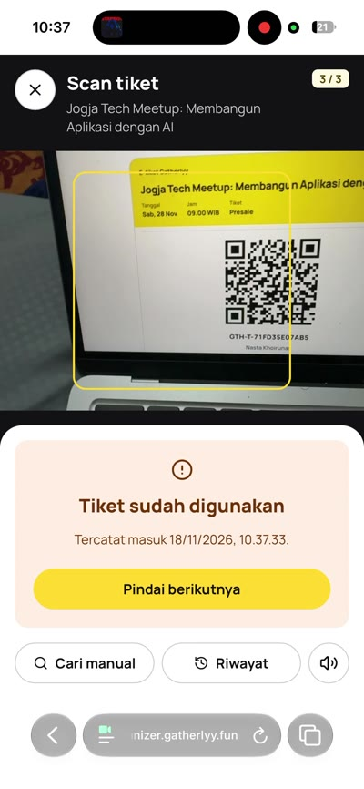
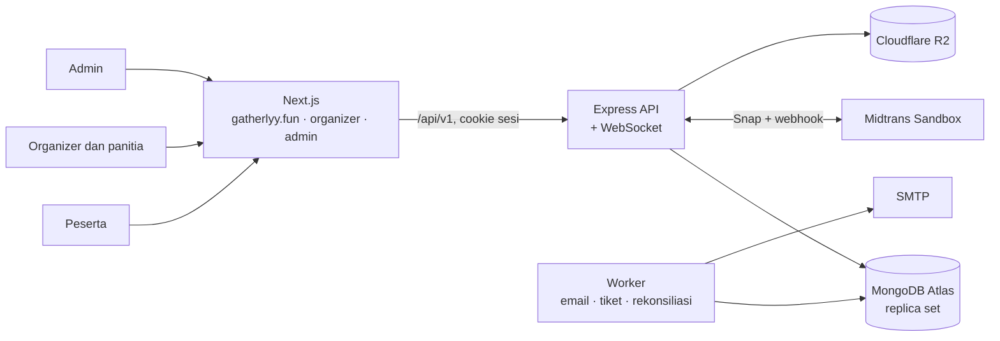
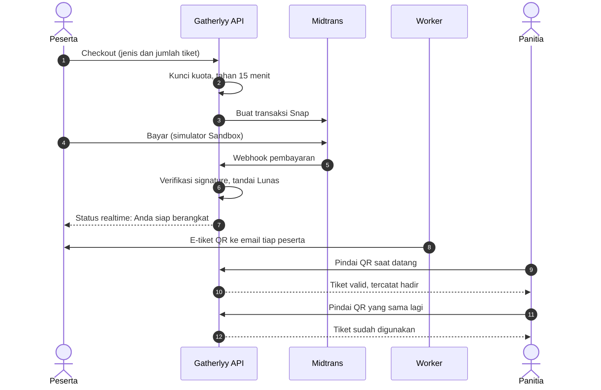

<p align="center">
  
</p>

<h1 align="center">Gatherlyy</h1>

<p align="center">
  <strong>Discover events. Book your spot. Be there.</strong><br>
  Platform acara komunitas dengan reservasi kuota, pembayaran sandbox, tiket QR, dan check-in.
</p>

<p align="center">
  <a href="https://gatherlyy.fun">Website</a> ·
  <a href="https://bit.ly/VideoDemo_Kel11_PAW">Video Demo</a> ·
  <a href="https://bit.ly/PPT_Kel11_PAW">Presentasi</a> ·
  <a href="docs/README.md">Dokumentasi</a> ·
  <a href="docs/requirements.md">Analisis Kebutuhan</a> ·
  <a href="docs/api-contract.md">Kontrak API</a> ·
  <a href="postman/README.md">Postman</a> ·
  <a href="https://github.com/users/kuchikamizake05/projects/3/views/1">Project Board</a>
</p>

<p align="center">
  <a href="#tautan-cepat">Tautan Cepat</a> ·
  <a href="#deskripsi">Deskripsi</a> ·
  <a href="#tampilan">Tampilan</a> ·
  <a href="#fitur">Fitur</a> ·
  <a href="#cara-kerja">Cara Kerja</a> ·
  <a href="#mencoba-aplikasi">Mencoba Aplikasi</a> ·
  <a href="#ringkasan-api">Ringkasan API</a> ·
  <a href="#menjalankan-secara-lokal">Menjalankan Lokal</a>
</p>

## Tautan Cepat

| | |
| --- | --- |
| **Situs peserta** | [gatherlyy.fun](https://gatherlyy.fun) |
| **Workspace organizer dan panitia** | [organizer.gatherlyy.fun](https://organizer.gatherlyy.fun) |
| **Konsol admin** | [admin.gatherlyy.fun](https://admin.gatherlyy.fun) (akun demo ada di [panduan mencoba](docs/panduan-mencoba.md)) |
| **API** | [api.gatherlyy.fun/api/v1/health](https://api.gatherlyy.fun/api/v1/health) · [Swagger](https://api.gatherlyy.fun/api/v1/docs/) |
| **Video presentasi dan demo** | [bit.ly/VideoDemo_Kel11_PAW](https://bit.ly/VideoDemo_Kel11_PAW) |
| **Presentasi** | [bit.ly/PPT_Kel11_PAW](https://bit.ly/PPT_Kel11_PAW) |
| **Laporan Milestone 1** | [PAW2026_M1_Kelompok 11.pdf](https://drive.google.com/file/d/1jbkOKAdMCIKqKcThbcAU_jo6EtpathBQ/view?usp=sharing) |
| **Panduan mencoba** | [docs/panduan-mencoba.md](docs/panduan-mencoba.md) |
| **Dokumentasi** | [docs](docs/README.md) · [Postman](postman/README.md) · [Project Board](https://github.com/users/kuchikamizake05/projects/3/views/1) |

## Deskripsi

Gatherlyy membantu peserta menemukan dan membeli tiket acara komunitas, organizer mengelola acara serta penjualan, panitia memvalidasi tiket di lokasi, dan tim Gatherlyy meninjau organizer serta pencairan dana. Proyek ini dikembangkan oleh **Kelompok 11** untuk mata kuliah **Pengembangan Aplikasi Web**, topik **US3 — Tiket acara komunitas: kuota dan tiket elektronik berkode**.

Satu aplikasi Next.js melayani tiga host:

| Host | Untuk | Lokal |
| --- | --- | --- |
| `gatherlyy.fun` | Peserta: jelajah acara, checkout, Tiketku, akun, pengajuan organizer | `localhost:3000` |
| `organizer.gatherlyy.fun` | Organizer dan panitia: acara, penjualan, peserta, tim, pencairan, scan tiket | `organizer.localhost:3000` |
| `admin.gatherlyy.fun` | Tim Gatherlyy: tinjau pengajuan, organizer, pencairan, laporan | `admin.localhost:3000` |

Mode live selalu memakai HTTP asli ke backend. Data contoh hanya aktif dengan `NEXT_PUBLIC_API_MOCK=true` dan tidak membuktikan integrasi transaksi.

### Masalah yang diselesaikan

Banyak acara komunitas masih menjual tiket lewat formulir online dan transfer manual. Panitia harus mengecek pembayaran dan mencatat peserta satu per satu, dan saat banyak orang memesan hampir bersamaan, kuota tiket mudah terlampaui. Di lokasi, daftar hadir dicocokkan secara manual sehingga satu bukti pembayaran bisa dipakai lebih dari sekali.

Gatherlyy menyatukan proses itu dalam satu alur:

- **Kuota tidak terlampaui.** Kuota dikunci saat checkout dan ditahan 15 menit selama peserta membayar.
- **Pembayaran terkonfirmasi otomatis.** Status pesanan berubah dari notifikasi Midtrans, tanpa pengecekan bukti transfer.
- **Satu tiket, satu kali masuk.** Setiap peserta mendapat e-tiket berkode QR, dan panitia memindainya. Pemindaian kedua untuk tiket yang sama ditolak.

## Tampilan

<table>
  <tr>
    <td width="50%"><br><sub>Beranda: cari acara dan kategori</sub></td>
    <td width="50%"><br><sub>Detail acara dan pilihan tiket</sub></td>
  </tr>
  <tr>
    <td><br><sub>E-tiket berkode QR di Tiketku</sub></td>
    <td><br><sub>Organizer: ringkasan penjualan per acara</sub></td>
  </tr>
</table>

<p align="center">
  
  &nbsp;&nbsp;
  <br>
  <sub>Panitia memindai QR dari ponsel: tiket valid, lalu ditolak saat dipindai ulang</sub>
</p>

## Nama dan Daftar Anggota

**Kelompok 11**

| Nama | NIM | Peran |
| --- | --- | --- |
| Dien Muhammad Scientivan Kurniapramono | 24/533571/TK/59114 | Backend 2 |
| Aulia Nur Fajri Tri Anggoro | 24/535054/TK/59327 | Frontend 1 |
| Muhammad Khoirunas | 24/533373/TK/59083 | Frontend 2 |
| Faaid Sakhaa | 24/539398/TK/59820 | Backend 1 / Ketua |

## Fitur

| Area | Kemampuan |
| --- | --- |
| Akun | Register dan login dengan email OTP, Google OAuth, sesi HttpOnly, CSRF, lupa password, dan hapus akun |
| Jelajah | Pencarian dengan saran, filter tanggal, harga, kategori, dan kota (514 kabupaten dan kota), urutan, acara disimpan, profil penyelenggara |
| Checkout | Reservasi kuota atomik dengan idempotency key, tiket ditahan 15 menit, data tiap peserta, biaya layanan 5%, penawaran jumlah tersisa bila kuota berubah |
| Pembayaran | Midtrans Snap Sandbox, webhook terverifikasi, status pesanan realtime lewat WebSocket dengan polling sebagai cadangan |
| Tiket | Satu e-tiket berkode QR per peserta, dikirim ke email tiap peserta, tautan e-tiket tanpa login, PDF, tambah ke kalender, kirim ulang |
| Pengembalian dana | Pembeli mengajukan per tiket sampai satu bulan sebelum acara, ditinjau admin, biaya layanan tidak dikembalikan. Organizer dapat meminta pembatalan acara; setelah disetujui admin, dana pembeli dikembalikan penuh |
| Workspace organizer | Buat dan edit acara (wizard dengan draf otomatis), jenis tiket, pesanan, peserta, ekspor CSV, tim dan panitia per acara, profil, rekening dan pencairan |
| Check-in | Scan QR atau cari manual, wajib online, jendela waktu scan per acara, sekali pakai secara atomik, riwayat dari semua panitia |
| Admin | Login dengan 2FA authenticator (TOTP) dan kode cadangan, tinjau pengajuan organizer, kelola dan bekukan organizer, putuskan pembatalan acara dan pengembalian dana, tandai pencairan sudah ditransfer, tinjau laporan acara |
| Unggahan | Poster dan dokumen di Cloudflare R2, dokumen identitas privat lewat signed URL |

## Cara Kerja

### Arsitektur

Gatherlyy adalah *modular monolith*: satu frontend Next.js untuk tiga host dan satu API Express yang memegang seluruh aturan bisnis. Pekerjaan latar (email, penerbitan tiket, rekonsiliasi pembayaran, pengingat) berjalan di proses worker terpisah.



- Browser hanya memanggil `/api/v1` di origin yang sama, lalu diteruskan ke API. Komponen frontend tidak pernah mengakses database langsung.
- Kuota, pesanan, dan tiket diubah dalam transaksi MongoDB supaya tidak ada tiket ganda atau kuota terlampaui.
- Status pesanan dikirim ke browser lewat WebSocket, dengan polling sebagai cadangan.

### Alur pesanan sampai check-in



Bila pembayaran tidak selesai dalam 15 menit, reservasi dilepas dan kuota kembali tersedia. Job rekonsiliasi memeriksa ulang pesanan yang tertunda bila webhook terlambat.

## Struktur Folder dan File Proyek

```text
Gatherly/
├── apps/
│   ├── backend/
│   │   ├── src/
│   │   │   ├── config/       Validasi environment dan koneksi MongoDB
│   │   │   ├── docs/         Spesifikasi OpenAPI dan halaman Swagger
│   │   │   ├── jobs/         Rekonsiliasi pembayaran, penerbitan tiket, pengingat
│   │   │   ├── lib/          Utilitas, rate limit, dan penanganan error
│   │   │   ├── modules/      Auth, akun, acara, order, pembayaran, tiket, check-in,
│   │   │   │                 refund, payout, workspace, admin, realtime, storage
│   │   │   ├── app.ts        Rute dan middleware Express
│   │   │   ├── server.ts     Server API dan WebSocket
│   │   │   └── worker.ts     Proses latar: job terjadwal dan email
│   │   ├── deploy/          Caddy, service systemd API dan worker, skrip deploy VPS
│   │   ├── scripts/         Provisioning akun admin dan aset Swagger
│   │   ├── test/            Tes integrasi dan smoke test Midtrans
│   │   ├── .env.example     Contoh variabel environment tanpa secret nyata
│   │   └── package.json     Script dan dependency backend
│   └── frontend/
│       ├── app/             Rute Next.js: (main) situs utama, organizer, admin
│       ├── proxy.ts         Membagi tiga host ke folder rute masing-masing
│       ├── src/components/  Komponen UI bersama (ui, elements, layout)
│       ├── src/modules/     Fitur per modul: api, hooks, dan komponen
│       ├── src/lib/         Klien API, domain situs, format, data wilayah
│       ├── test/            Tes Playwright dan tes browser admin
│       └── package.json     Script dan dependency frontend
├── design/                  Struktur kanvas desain (pen.dev)
├── docs/
│   ├── requirements.md, user-flows.md, architecture.md, data-model.md
│   ├── api-contract.md, testing.md, integrations.md, team-workflow.md
│   ├── deployment-vps.md, deployment-frontend.md, deployment-vercel.md
│   ├── panduan-mencoba.md   Langkah mencoba aplikasi dan akun admin demo
│   ├── demo-data.md         Isi dan cara mengisi data contoh
│   ├── screenshots/         Gambar tampilan untuk README
│   └── implementation/      Catatan handoff dan demo per bagian
├── postman/                 Koleksi, environment, dan panduan request
├── README.md                Panduan proyek ini
└── package.json             Metadata repository, bukan npm workspace
```

Aplikasi:

- `@gatherly/backend` (dalam `apps/backend`)
- `@gatherly/frontend` (dalam `apps/frontend`)

## Teknologi

| Lapisan | Teknologi |
| --- | --- |
| Web | Next.js 16, React 19, TypeScript, Tailwind CSS 4, TanStack Query, React Hook Form, Zod |
| API | Express 5, TypeScript, Zod, WebSocket (`ws`) |
| Database | MongoDB Atlas dan Mongoose |
| Pembayaran | Midtrans Snap Sandbox |
| Email dan berkas | Nodemailer (SMTP), PDFKit, Cloudflare R2 (API S3) |
| Keamanan | bcrypt, email OTP, Google OAuth state, TOTP admin, cookie HttpOnly, CSRF, Helmet, rate limiting |
| Tooling | pnpm per aplikasi, Node test runner, Playwright, Postman |

## URL Laporan Milestone 1

Dokumentasi proyek tersedia dalam folder [`docs`](docs/README.md).

**Laporan PDF final:** [PAW2026_M1_Kelompok 11.pdf](https://drive.google.com/file/d/1jbkOKAdMCIKqKcThbcAU_jo6EtpathBQ/view?usp=sharing).

## URL Milestone 2

- **Aplikasi web:** [gatherlyy.fun](https://gatherlyy.fun)
- **Video presentasi dan demonstrasi:** [Video Demo Kelompok 11](https://bit.ly/VideoDemo_Kel11_PAW)
- **File presentasi:** [PPT Kelompok 11](https://bit.ly/PPT_Kel11_PAW)
- **Repositori:** [Gatherlyy di GitHub](https://github.com/kuchikamizake05/Gatherlyy)

## Mencoba Aplikasi

Aplikasi bisa langsung dicoba di produksi tanpa memasang apa pun. Pembayaran memakai Midtrans mode Sandbox, jadi tidak ada uang sungguhan.

| Peran | Alamat | Akun |
| --- | --- | --- |
| Peserta | [gatherlyy.fun](https://gatherlyy.fun) | Daftar sendiri dengan email atau Google |
| Organizer dan panitia | [organizer.gatherlyy.fun](https://organizer.gatherlyy.fun) | Ajukan diri sebagai organizer, lalu setujui dengan akun admin demo |
| Admin | [admin.gatherlyy.fun](https://admin.gatherlyy.fun) | `demo@gatherlyy.fun` / `Demo-ArwUvveEc2My`, kode 2FA dari kunci authenticator di panduan |

Ringkasan alurnya:

1. **Peserta**: daftar, cari acara, beli tiket, bayar lewat [simulator Midtrans](https://simulator.sandbox.midtrans.com/bca/va/index), lalu buka e-tiket di **Tiketku**.
2. **Organizer**: ajukan diri di [halaman pengajuan](https://gatherlyy.fun/become-organizer), setujui pengajuannya dari konsol admin, masuk dengan kredensial dari email, lalu buat dan kelola acara.
3. **Panitia**: organizer menambah anggota tim dan menugaskannya ke acara. Panitia memindai QR e-tiket. Pemindaian kedua untuk tiket yang sama ditolak.
4. **Admin**: tinjau pengajuan organizer, kelola organizer, putuskan pembatalan acara dan pengembalian dana, tandai pencairan, dan tinjau laporan.

Langkah lengkap, kunci authenticator, dan kode cadangan admin ada di [panduan mencoba](docs/panduan-mencoba.md).

## Deployment

| Bagian | Alamat | Keterangan |
| --- | --- | --- |
| Backend | [api.gatherlyy.fun](https://api.gatherlyy.fun/api/v1/health) · [Swagger](https://api.gatherlyy.fun/api/v1/docs/) | VPS dengan Caddy, service API dan worker terpisah. Lihat [panduan deployment VPS](docs/deployment-vps.md) |
| Frontend | [gatherlyy.fun](https://gatherlyy.fun) · [organizer.gatherlyy.fun](https://organizer.gatherlyy.fun) · [admin.gatherlyy.fun](https://admin.gatherlyy.fun) | Lihat [panduan deployment frontend](docs/deployment-frontend.md) |
| Video demo | [Video presentasi dan demonstrasi](https://bit.ly/VideoDemo_Kel11_PAW) | Presentasi kelompok dan demo aplikasi |
| Presentasi | [PPT Kelompok 11](https://bit.ly/PPT_Kel11_PAW) | Materi presentasi akhir |

Domain frontend diatur lewat `NEXT_PUBLIC_SITE_DOMAIN`, dan domain email admin lewat `ADMIN_EMAIL_DOMAIN` di backend.

## Ringkasan API

Semua endpoint ada di bawah `/api/v1`. Dokumentasi lengkap dengan contoh request ada di [Swagger](https://api.gatherlyy.fun/api/v1/docs/), [kontrak API](docs/api-contract.md), dan [koleksi Postman](postman/README.md).

| Kelompok | Prefix | Isi |
| --- | --- | --- |
| Kesehatan | `/health` | Status API |
| Autentikasi peserta | `/auth` | Register, verifikasi email OTP, login, Google OAuth, lupa password, logout |
| Akun | `/me`, `/account` | Profil, acara disimpan, hapus akun |
| Acara publik | `/events`, `/organizers` | Katalog, pencarian dan filter, detail acara, profil penyelenggara, laporan acara |
| Pengajuan organizer | `/organizer-applications` | Kirim dan perbaiki pengajuan beserta dokumen |
| Pesanan dan pembayaran | `/orders`, `/payments` | Reservasi kuota, data peserta, transaksi Snap, webhook Midtrans |
| Tiket dan refund | `/tickets`, `/refunds` | E-tiket, PDF, tautan bagikan, kirim ulang, pengajuan pengembalian dana |
| Workspace | `/workspace/auth`, `/organizer` | Login organizer dan panitia, acara, jenis tiket, pesanan, peserta, tim, profil, pencairan |
| Check-in | `/committee/events` | Acara yang ditugaskan, pindai QR, cari manual, riwayat |
| Admin | `/admin/auth`, `/admin` | Login 2FA, pengajuan, organizer, keuangan, pencairan, laporan |
| Lainnya | `/media`, `/realtime` | Berkas poster dan dokumen, status pesanan lewat WebSocket |

## Menjalankan Secara Lokal

Persyaratan:

- Node.js 22 atau versi LTS yang kompatibel;
- pnpm (diuji dengan v11 dan v12);
- MongoDB replica set atau MongoDB Atlas untuk transaksi;
- Midtrans Server Key dalam mode Sandbox;
- akun SMTP (Gmail App Password dapat dipakai untuk demo);
- Google OAuth Client ID dan Client Secret;
- bucket Cloudflare R2 untuk unggahan.

### 1. Menjalankan Backend (`apps/backend`)

```bash
cd apps/backend
cp .env.example .env
pnpm install
pnpm dev          # API dan WebSocket
pnpm dev:worker   # job terjadwal dan email, di terminal lain
```

- API: `http://localhost:4000/api/v1`
- Swagger UI: `http://localhost:4000/api/v1/docs`
- Health check: `http://localhost:4000/api/v1/health`

Akun admin dibuat lewat skrip, tidak ada pendaftaran admin dari luar:

```bash
PROVISION_MODE=admin ADMIN_SEED_EMAIL=nama@gatherlyy.fun ADMIN_SEED_NAME=Nama \
ADMIN_SEED_PASSWORD=... ADMIN_SEED_TOTP_SECRET=... ADMIN_SEED_BACKUP_CODES=kode1,kode2 \
node --import tsx scripts/provision-accounts.mjs
```

Secret TOTP berupa string base32 acak yang juga dimasukkan ke aplikasi authenticator. Kirim secret dan kode cadangan ke admin lewat jalur pribadi.

### 2. Menjalankan Frontend (`apps/frontend`)

```bash
cd apps/frontend
cp .env.example .env.local
pnpm install
pnpm dev
```

- Situs utama: `http://localhost:3000`
- Workspace organizer dan panitia: `http://organizer.localhost:3000`
- Konsol admin: `http://admin.localhost:3000`

Untuk demo antarmuka tanpa backend, isi `NEXT_PUBLIC_API_MOCK=true` di `.env.local`. Akun contoh:

| Host | Akun |
| --- | --- |
| Organizer | `kolektifsawah` / `GatherlyDemo2026!` |
| Admin | `nadia@gatherlyy.fun` / `GatherlyDemo123!`, kode 2FA `123456` |

Akun contoh hanya berlaku di mode data contoh. Lihat [panduan demo](docs/implementation/workspace-demo.md) dan [batas kontrak integrasi](docs/implementation/workspace-api-handoff.md).

Jangan commit `.env`, `.env.local`, MongoDB URI, Midtrans Server Key, kunci R2, secret TOTP, cookie sesi, atau QR credential. Satu-satunya pengecualian adalah akun admin demo di [panduan mencoba](docs/panduan-mencoba.md), yang sengaja dibuka untuk penilaian dan akan dinonaktifkan setelahnya.

## Pemeriksaan Kualitas

Frontend:

```bash
cd apps/frontend
pnpm typecheck
pnpm build
pnpm exec playwright install chromium
pnpm test:e2e
```

E2E mencakup organizer dan panitia pada lebar 390, 834, dan 1440 px dengan data contoh. Kamera perangkat fisik dan alur transaksi backend perlu pemeriksaan integrasi terpisah.

Backend:

```bash
cd apps/backend
pnpm typecheck
pnpm build
pnpm test:integration
```

Tes integrasi memakai database `gatherly_test` dan menolak pembersihan database dengan nama lain. Pastikan `MONGODB_URI` mengarah ke cluster test yang aman sebelum menjalankannya.

Smoke test Midtrans Sandbox dapat dijalankan terpisah:

```bash
cd apps/backend
pnpm test:smoke:midtrans
```

## Dokumentasi API dengan Postman

Import kedua file berikut:

- [`Gatherly API.postman_collection.json`](postman/Gatherly%20API.postman_collection.json)
- [`Gatherly Local.postman_environment.json`](postman/Gatherly%20Local.postman_environment.json)

Panduan urutan request, pergantian role, penyimpanan example response, dan aturan credential tersedia di [postman/README.md](postman/README.md).

