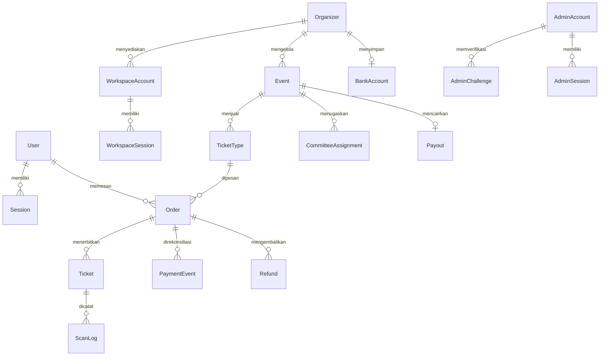

# Gatherly — Model Data dan Transisi Status

Ditinjau terhadap kode `main` ad1a181 (17 November 2026), untuk issue #4. Dokumen ini menjelaskan schema Mongoose yang diimplementasikan; bukan bukti bahwa index sudah terpasang pada database deployment. Inventaris di bawah diperoleh dengan mengimpor schema tanpa membuka koneksi database.

## Relasi dan batas aggregate

Relasi diagram bersifat logis: MongoDB tidak memberlakukan foreign key. Field `ref` schema ditampilkan pada inventaris; ID tanpa `ref` juga dapat merujuk resource secara logis. Satu order hanya memuat satu acara dan satu jenis tiket, quantity 1–4 dengan satu nama peserta per tiket. Harga, data acara, dan nama jenis tiket disalin ke order/ticket agar riwayat tidak bergantung pada perubahan katalog. Data PIC, alamat, performers, dan snapshot yang dibaca bersama disimpan embedded; relasi bertumbuh seperti order, tiket, scan, dan job dipisahkan.

## Invarian transaksi

- `TicketType.available = capacity - reserved - sold`. Reservasi menggunakan transaksi MongoDB dan perubahan bersyarat; transaksi memerlukan replica set. Unique `(buyerId, idempotencyKey)` mencegah retry membuat order kedua; payload berbeda dengan key sama ditolak.
- `Order.unitPrice`, `subtotalAmount`, `serviceFeeAmount`, `totalAmount`, serta nominal refund/payout adalah integer rupiah. Biaya layanan **ditambahkan 5%** pada harga dasar: Rp100.000 menjadi Rp105.000; Rp100.000 tetap dasar hak organizer.
- Pembayaran diverifikasi di server terhadap status/nominal provider. `PaymentEvent.fingerprint` unik untuk deduplikasi. Status provider yang belum pasti direkonsiliasi; kuota tidak dilepas hanya karena request timeout.
- Unique `(orderId, sequence)` dan token QR unik menjaga penerbitan satu tiket per posisi peserta. Worker memakai lease/retry; jangan mengartikan lease sebagai jaminan exactly-once untuk seluruh efek eksternal.
- Check-in memerlukan koneksi online, assignment aktif, acara/jendela waktu yang sesuai, dan pembaruan bersyarat `unused → used`. Percobaan dicatat dalam `ScanLog`; tidak ada sinkronisasi check-in offline.
- Refund dan payout mengunci aggregate keuangan acara melalui `financialVersion` dalam transaksi. Payout hanya untuk acara selesai, tanpa pembatalan/pengembalian yang menghalangi, saldo positif dan rekening tersimpan; unique `Payout.eventId` mencegah dua payout untuk acara sama.

## State machine yang diimplementasikan

| Aggregate / field | Nilai tersimpan dan transisi | Penjaga / alasan |
| --- | --- | --- |
| Event.publicationStatus | `draft → published → cancelled` | Publish memerlukan data/poster/tiket; cancelled setelah keputusan admin. `ended` dihitung dari waktu, bukan enum publicationStatus. |
| Event.cancellationStatus | `requested → approved / rejected` | Organizer meminta pembatalan; admin memutuskan. Persetujuan menjadwalkan pengembalian. |
| TicketType.salesStopped | `false ↔ true` | Endpoint stop/resume per jenis; terpisah dari `Event.salesClosed`. |
| Order.paymentStatus | `pending → paid / failed / expired` | Keputusan berdasarkan provider, termasuk rekonsiliasi; pembatalan lokal dicatat `cancelledAt/cancelledBy`, bukan enum `cancelled`. |
| Order.reservationStatus | `held → converted / released` | Konversi saat paid; pelepasan saat kegagalan/kedaluwarsa/pembatalan yang sudah dipastikan. Update bersyarat mencegah perubahan kuota berulang. |
| Order.paymentSessionState | `not_started → creating → ready / uncertain → closed` | Panggilan Snap memakai lease; timeout tidak langsung dianggap gagal. Retry/reconciliation mengikuti service. |
| Order.issuanceStatus | `not_ready → processing → issued` | Issuance untuk paid; lease dan unique sequence mendukung pemulihan. |
| Ticket.checkInStatus | `unused → used` atau `unused → cancelled` | Scan valid sekali; refund/pembatalan membatalkan tiket yang sesuai. Tidak ada reset melalui endpoint publik. |
| Order.refundStatus | `none / partial / full` | Ringkasan uang yang dikembalikan; terpisah dari status pembayaran. |
| Refund.status | `requested → approved / rejected`; `approved → processing → refunded / manual_required` | Worker/retry provider; penyelesaian manual dicatat dengan referensi transfer. Lihat `refund.service.ts` untuk retry/lease. |
| Payout.status | `requested → transferred` | Transfer bank manual, admin mencatat bukti/referensi dan tanggal; bukan integrasi bank otomatis. |
| OrganizerApplication.status | Lihat enum aktual pada inventaris | Review memakai `version` compare-and-set; approve wajib email PIC terverifikasi, username tersedia, dan flag terselesaikan. |
| EmailJob.state | `queued / sending / sent / failed` | Unique key, lease, attempts dan backoff; pengiriman SMTP bukan transaksi atomik dengan provider. |

Refund pembeli memerlukan tiket paid yang belum dipakai dan batas satu bulan kalender sebelum acara (timezone acara; akhir bulan di-clamp). Biaya layanan tidak dikembalikan pada refund pembeli; pembatalan acara memakai kebijakan pengembalian termasuk biaya layanan. Nilai `refundedAmount` dan `refundedBaseAmount` dipisahkan agar saldo organizer tidak menghitung fee.

## Index, retensi, dan akses data

- Unique index mendukung email/username, token, idempotency, QR, assignment, saved-event, dan payout. Compound index mendukung daftar buyer, rekonsiliasi, issuance, dan laporan kehadiran. Inventaris mencatat seluruh index deklaratif, termasuk partial/sparse/TTL.
- TTL membersihkan sesi/challenge/state/grant/rate-limit kedaluwarsa secara asinkron; autentikasi tetap memeriksa `expiresAt`, tidak menunggu penghapusan TTL. RealtimeEvent TTL satu jam.
- `EmailJob.expiresAt`, `StorageAsset.deleteAfter`, dan retensi dokumen aplikasi bukan otomatis TTL; worker melakukan pemeliharaan. Dokumen aplikasi tertentu dijadwalkan dihapus setelah 90 hari sesuai jalur keputusan.
- Password memakai bcrypt; token sesi/reset disimpan sebagai hash. CSRF buyer tersimpan hash, sedangkan workspace/admin menyimpan token CSRF pada record sesi. Secret TOTP admin terenkripsi, backup code berupa hash. Nomor rekening dan PIC bukan seluruhnya terenkripsi di database; jangan mengklaim enkripsi menyeluruh.
- QR token `select:false` dan tautan `/tickets/shared/{token}` merupakan credential pembawa. Berkas identitas private R2 memakai signed URL saat review; asset publik dipisahkan. Jangan memasukkan token, dokumen identitas, nomor rekening, atau secret ke log/bukti publik.
- AuditLog adalah collection aplikasi dengan timestamps; tidak ada jaminan penyimpanan immutable pada level database.

## Inventaris schema aktual

Nama collection berikut berasal dari Mongoose runtime. `_id` dan timestamps ditampilkan bila ada; tidak diasumsikan semua schema memiliki timestamps. Field nested ditampilkan dengan dot notation. `ref` hanya dicatat bila dideklarasikan schema. Daftar ini menyatakan bentuk penyimpanan, bukan DTO API (field rahasia tidak otomatis boleh dikirim).

### AdminAccount — `adminaccounts`

| Field | Tipe | Ref / enum |
| --- | --- | --- |
| `email` | String | — |
| `name` | String | — |
| `passwordHash` | String | — |
| `totpSecretEncrypted` | String | — |
| `backupCodeHashes` | Array | — |
| `active` | Boolean | — |
| `primary` | Boolean | — |
| `failures` | Number | — |
| `lockedUntil` | Date | — |
| `lastTotpCounter` | Number | — |
| `_id` | ObjectId | — |
| `createdAt` | Date | — |
| `updatedAt` | Date | — |

Index deklaratif (selain `_id` bawaan MongoDB):

- `{"email":1}` — `{"unique":true}`

### AdminChallenge — `adminchallenges`

| Field | Tipe | Ref / enum |
| --- | --- | --- |
| `accountId` | ObjectId | ref AdminAccount |
| `tokenHash` | String | — |
| `attempts` | Number | — |
| `usedAt` | Date | — |
| `expiresAt` | Date | — |
| `_id` | ObjectId | — |
| `createdAt` | Date | — |
| `updatedAt` | Date | — |

Index deklaratif (selain `_id` bawaan MongoDB):

- `{"tokenHash":1}` — `{"unique":true}`
- `{"expiresAt":1}` — `{"expireAfterSeconds":0}`

### AdminSession — `adminsessions`

| Field | Tipe | Ref / enum |
| --- | --- | --- |
| `accountId` | ObjectId | ref AdminAccount |
| `tokenHash` | String | — |
| `csrfToken` | String | — |
| `expiresAt` | Date | — |
| `_id` | ObjectId | — |
| `createdAt` | Date | — |
| `updatedAt` | Date | — |

Index deklaratif (selain `_id` bawaan MongoDB):

- `{"tokenHash":1}` — `{"unique":true}`
- `{"expiresAt":1}` — `{"expireAfterSeconds":0}`

### ApplicationCounter — `applicationcounters`

| Field | Tipe | Ref / enum |
| --- | --- | --- |
| `month` | String | — |
| `sequence` | Number | — |
| `_id` | ObjectId | — |

Index deklaratif (selain `_id` bawaan MongoDB):

- `{"month":1}` — `{"unique":true}`

### ApplicationDocument — `applicationdocuments`

| Field | Tipe | Ref / enum |
| --- | --- | --- |
| `storageId` | String | — |
| `ownerTokenHash` | String | — |
| `name` | String | — |
| `type` | String | — |
| `size` | Number | — |
| `applicationId` | ObjectId | ref OrganizerApplication |
| `_id` | ObjectId | — |
| `createdAt` | Date | — |
| `updatedAt` | Date | — |

Index deklaratif (selain `_id` bawaan MongoDB):

- `{"storageId":1}` — `{"unique":true}`
- `{"ownerTokenHash":1}` — `{}`

### AuditLog — `auditlogs`

| Field | Tipe | Ref / enum |
| --- | --- | --- |
| `actorId` | String | — |
| `action` | String | — |
| `targetId` | String | — |
| `note` | String | — |
| `_id` | ObjectId | — |
| `createdAt` | Date | — |
| `updatedAt` | Date | — |

Index deklaratif (selain `_id` bawaan MongoDB):

- `{"actorId":1}` — `{}`
- `{"targetId":1}` — `{}`

### AuthChallenge — `authchallenges`

| Field | Tipe | Ref / enum |
| --- | --- | --- |
| `purpose` | String | `register`, `login` |
| `emailNormalized` | String | — |
| `userId` | ObjectId | ref User |
| `name` | String | — |
| `passwordHash` | String | — |
| `codeHash` | String | — |
| `expiresAt` | Date | — |
| `resendAt` | Date | — |
| `attempts` | Number | — |
| `usedAt` | Date | — |
| `_id` | ObjectId | — |
| `createdAt` | Date | — |
| `updatedAt` | Date | — |

Index deklaratif (selain `_id` bawaan MongoDB):

- `{"emailNormalized":1}` — `{}`
- `{"expiresAt":1}` — `{"expireAfterSeconds":0}`
- `{"emailNormalized":1,"purpose":1,"createdAt":-1}` — `{}`

### BankAccount — `bankaccounts`

| Field | Tipe | Ref / enum |
| --- | --- | --- |
| `organizerId` | ObjectId | ref Organizer |
| `bank` | String | — |
| `accountNumber` | String | — |
| `holderName` | String | — |
| `_id` | ObjectId | — |
| `createdAt` | Date | — |
| `updatedAt` | Date | — |

Index deklaratif (selain `_id` bawaan MongoDB):

- `{"organizerId":1}` — `{"unique":true}`

### CommitteeAssignment — `committeeassignments`

| Field | Tipe | Ref / enum |
| --- | --- | --- |
| `eventId` | ObjectId | — |
| `userId` | ObjectId | ref User |
| `assignedBy` | ObjectId | ref User |
| `checkInVersion` | Number | — |
| `_id` | ObjectId | — |
| `createdAt` | Date | — |
| `updatedAt` | Date | — |

Index deklaratif (selain `_id` bawaan MongoDB):

- `{"eventId":1}` — `{}`
- `{"userId":1}` — `{}`
- `{"eventId":1,"userId":1}` — `{"unique":true}`

### EmailJob — `emailjobs`

| Field | Tipe | Ref / enum |
| --- | --- | --- |
| `key` | String | — |
| `to` | String | — |
| `subject` | String | — |
| `text` | String | — |
| `html` | String | — |
| `attachments` | Array | — |
| `state` | String | `queued`, `sending`, `sent`, `failed` |
| `attempts` | Number | — |
| `nextAttemptAt` | Date | — |
| `leaseUntil` | Date | — |
| `leaseToken` | String | — |
| `expiresAt` | Date | — |
| `sentAt` | Date | — |
| `lastError` | String | — |
| `_id` | ObjectId | — |
| `createdAt` | Date | — |
| `updatedAt` | Date | — |

Index deklaratif (selain `_id` bawaan MongoDB):

- `{"key":1}` — `{"unique":true}`
- `{"nextAttemptAt":1}` — `{}`

### Event — `events`

| Field | Tipe | Ref / enum |
| --- | --- | --- |
| `organizerId` | ObjectId | ref Organizer |
| `slug` | String | — |
| `title` | String | — |
| `description` | String | — |
| `category` | String | — |
| `startsAt` | Date | — |
| `endsAt` | Date | — |
| `timezone` | String | — |
| `venueName` | String | — |
| `address` | String | — |
| `city` | String | — |
| `posterAssetId` | String | — |
| `publicationStatus` | String | `draft`, `published`, `cancelled` |
| `salesClosed` | Boolean | — |
| `locationType` | String | `offline`, `online` |
| `terms` | Array | — |
| `performerLabel` | String | — |
| `performers` | Array | — |
| `showRemaining` | Boolean | — |
| `checkInOpensAt` | Date | — |
| `checkInClosesAt` | Date | — |
| `financialVersion` | Number | — |
| `cancellationStatus` | String | `requested`, `approved`, `rejected` |
| `cancellationReason` | String | — |
| `cancellationRequestedAt` | Date | — |
| `cancellationDecidedAt` | Date | — |
| `cancellationDecidedBy` | ObjectId | — |
| `cancellationDecisionNote` | String | — |
| `checkoutVersion` | Number | — |
| `_id` | ObjectId | — |
| `createdAt` | Date | — |
| `updatedAt` | Date | — |

Index deklaratif (selain `_id` bawaan MongoDB):

- `{"organizerId":1}` — `{}`
- `{"slug":1}` — `{"unique":true}`
- `{"startsAt":1}` — `{}`
- `{"publicationStatus":1}` — `{}`
- `{"organizerId":1,"publicationStatus":1,"startsAt":-1}` — `{}`

### EventReport — `eventreports`

| Field | Tipe | Ref / enum |
| --- | --- | --- |
| `eventId` | ObjectId | ref Event |
| `organizerId` | ObjectId | ref Organizer |
| `reporterId` | ObjectId | ref User |
| `eventTitle` | String | — |
| `organizerName` | String | — |
| `reason` | String | `fraud`, `wrong_info`, `inappropriate`, `other` |
| `note` | String | — |
| `status` | String | `new`, `done` |
| `resolutionNote` | String | — |
| `closedBy` | String | — |
| `closedAt` | Date | — |
| `_id` | ObjectId | — |
| `createdAt` | Date | — |
| `updatedAt` | Date | — |

Index deklaratif (selain `_id` bawaan MongoDB):

- `{"eventId":1}` — `{}`
- `{"organizerId":1}` — `{}`
- `{"status":1,"createdAt":-1}` — `{}`
- `{"reporterId":1,"eventId":1}` — `{"unique":true,"partialFilterExpression":{"status":"new"}}`

### OAuthState — `oauthstates`

| Field | Tipe | Ref / enum |
| --- | --- | --- |
| `stateHash` | String | — |
| `expiresAt` | Date | — |
| `usedAt` | Date | — |
| `_id` | ObjectId | — |
| `createdAt` | Date | — |
| `updatedAt` | Date | — |

Index deklaratif (selain `_id` bawaan MongoDB):

- `{"stateHash":1}` — `{"unique":true}`
- `{"expiresAt":1}` — `{"expireAfterSeconds":0}`

### Order — `orders`

| Field | Tipe | Ref / enum |
| --- | --- | --- |
| `buyerId` | ObjectId | ref User |
| `eventId` | ObjectId | ref Event |
| `ticketTypeId` | ObjectId | ref TicketType |
| `orderCode` | String | — |
| `providerOrderId` | String | — |
| `quantity` | Number | — |
| `attendees` | Array | — |
| `unitPrice` | Number | — |
| `totalAmount` | Number | — |
| `subtotalAmount` | Number | — |
| `serviceFeeAmount` | Number | — |
| `refundedAmount` | Number | — |
| `refundedBaseAmount` | Number | — |
| `refundStatus` | String | `none`, `partial`, `full` |
| `currency` | String | `IDR` |
| `eventSnapshot.slug` | String | — |
| `eventSnapshot.poster` | String | — |
| `eventSnapshot.endsAt` | Date | — |
| `eventSnapshot.title` | String | — |
| `eventSnapshot.startsAt` | Date | — |
| `eventSnapshot.timezone` | String | — |
| `eventSnapshot.venueName` | String | — |
| `eventSnapshot.address` | String | — |
| `eventSnapshot.city` | String | — |
| `ticketTypeSnapshot.name` | String | — |
| `ticketTypeSnapshot.unitPrice` | Number | — |
| `buyerSnapshot.name` | String | — |
| `buyerSnapshot.email` | String | — |
| `paymentStatus` | String | `pending`, `paid`, `failed`, `expired` |
| `reservationStatus` | String | `held`, `converted`, `released` |
| `issuanceStatus` | String | `not_ready`, `processing`, `issued` |
| `paymentSessionState` | String | `not_started`, `creating`, `ready`, `uncertain`, `closed` |
| `paymentMethod` | String | — |
| `contactPhone` | String | — |
| `cancelledAt` | Date | — |
| `cancelledBy` | String | `buyer`, `organizer` |
| `snapToken` | String | — |
| `redirectUrl` | String | — |
| `paymentSessionAttempts` | Number | — |
| `paymentSessionLastError` | String | — |
| `expiresAt` | Date | — |
| `idempotencyKey` | String | — |
| `requestHash` | String | — |
| `paymentTimeline` | Array | — |
| `nextReconcileAt` | Date | — |
| `reconcileMisses` | Number | — |
| `reconciliationRequired` | Boolean | — |
| `reconciliationReason` | String | — |
| `leaseUntil` | Date | — |
| `issuanceLeaseUntil` | Date | — |
| `issuanceNextAttemptAt` | Date | — |
| `issuanceAttempts` | Number | — |
| `issuanceLastError` | String | — |
| `paidAt` | Date | — |
| `_id` | ObjectId | — |
| `createdAt` | Date | — |
| `updatedAt` | Date | — |

Index deklaratif (selain `_id` bawaan MongoDB):

- `{"orderCode":1}` — `{"unique":true}`
- `{"providerOrderId":1}` — `{"unique":true}`
- `{"buyerId":1,"idempotencyKey":1}` — `{"unique":true}`
- `{"buyerId":1,"createdAt":-1,"_id":-1}` — `{}`
- `{"paymentStatus":1,"nextReconcileAt":1}` — `{}`
- `{"eventId":1,"paymentStatus":1,"paidAt":1}` — `{}`
- `{"paymentStatus":1,"reservationStatus":1,"issuanceStatus":1,"issuanceNextAttemptAt":1}` — `{}`

### Organizer — `organizers`

| Field | Tipe | Ref / enum |
| --- | --- | --- |
| `ownerId` | ObjectId | ref User |
| `name` | String | — |
| `description` | String | — |
| `contactEmail` | String | — |
| `username` | String | — |
| `city` | String | — |
| `logoUrl` | String | — |
| `links` | Array | — |
| `status` | String | `active`, `never_logged_in`, `frozen` |
| `frozenReason` | String | — |
| `applicationNumber` | String | — |
| `pic.name` | String | — |
| `pic.role` | String | — |
| `pic.email` | String | — |
| `pic.phone` | String | — |
| `_id` | ObjectId | — |
| `createdAt` | Date | — |
| `updatedAt` | Date | — |

Index deklaratif (selain `_id` bawaan MongoDB):

- `{"ownerId":1}` — `{"unique":true}`
- `{"username":1}` — `{"unique":true,"sparse":true}`

### OrganizerApplication — `organizerapplications`

| Field | Tipe | Ref / enum |
| --- | --- | --- |
| `number` | String | — |
| `organizerName` | String | — |
| `organizerType` | String | `komunitas`, `organisasi_kampus`, `perusahaan`, `individu` |
| `description` | String | — |
| `address.province` | String | — |
| `address.city` | String | — |
| `address.street` | String | — |
| `address.postalCode` | String | — |
| `links` | Array | — |
| `pic.name` | String | — |
| `pic.role` | String | — |
| `pic.email` | String | — |
| `pic.phone` | String | — |
| `username` | String | — |
| `ktp.id` | String | — |
| `ktp.name` | String | — |
| `ktp.type` | String | — |
| `ktp.size` | Number | — |
| `legalDocument.id` | String | — |
| `legalDocument.name` | String | — |
| `legalDocument.type` | String | — |
| `legalDocument.size` | Number | — |
| `status` | String | `new`, `needs_fix`, `fix_submitted`, `approved`, `rejected` |
| `activeEmail` | String | — |
| `submittedAt` | Date | — |
| `emailVerifiedAt` | Date | — |
| `emailVerificationHash` | String | — |
| `emailVerificationExpiresAt` | Date | — |
| `fixDeadline` | Date | — |
| `flags` | Array | — |
| `previousValues` | Mixed | — |
| `rejectionReason` | String | — |
| `decidedAt` | Date | — |
| `documentsExpireAt` | Date | — |
| `editTokenHash` | String | — |
| `editTokenExpiresAt` | Date | — |
| `version` | Number | — |
| `_id` | ObjectId | — |
| `createdAt` | Date | — |
| `updatedAt` | Date | — |

Index deklaratif (selain `_id` bawaan MongoDB):

- `{"number":1}` — `{"unique":true}`
- `{"status":1}` — `{}`
- `{"activeEmail":1}` — `{"unique":true,"sparse":true}`
- `{"pic.email":1,"createdAt":-1}` — `{}`

### PasswordReset — `passwordresets`

| Field | Tipe | Ref / enum |
| --- | --- | --- |
| `userId` | ObjectId | ref User |
| `tokenHash` | String | — |
| `expiresAt` | Date | — |
| `usedAt` | Date | — |
| `_id` | ObjectId | — |
| `createdAt` | Date | — |
| `updatedAt` | Date | — |

Index deklaratif (selain `_id` bawaan MongoDB):

- `{"userId":1}` — `{}`
- `{"tokenHash":1}` — `{"unique":true}`
- `{"expiresAt":1}` — `{"expireAfterSeconds":0}`

### PaymentEvent — `paymentevents`

| Field | Tipe | Ref / enum |
| --- | --- | --- |
| `providerOrderId` | String | — |
| `providerTransactionId` | String | — |
| `fingerprint` | String | — |
| `providerStatus` | String | — |
| `normalizedStatus` | String | `paid`, `pending`, `failed`, `expired`, `review` |
| `processingStatus` | String | `received`, `processed`, `retry` |
| `receivedAt` | Date | — |
| `processedAt` | Date | — |
| `errorCode` | String | — |
| `_id` | ObjectId | — |

Index deklaratif (selain `_id` bawaan MongoDB):

- `{"providerOrderId":1}` — `{}`
- `{"fingerprint":1}` — `{"unique":true}`
- `{"processingStatus":1}` — `{}`
- `{"processingStatus":1,"receivedAt":1}` — `{}`

### Payout — `payouts`

| Field | Tipe | Ref / enum |
| --- | --- | --- |
| `organizerId` | ObjectId | ref Organizer |
| `eventId` | ObjectId | ref Event |
| `amount` | Number | — |
| `bank` | String | — |
| `accountNumber` | String | — |
| `holderName` | String | — |
| `status` | String | `requested`, `transferred` |
| `requestedAt` | Date | — |
| `transferredAt` | Date | — |
| `transferReference` | String | — |
| `transferredBy` | ObjectId | — |
| `_id` | ObjectId | — |
| `createdAt` | Date | — |
| `updatedAt` | Date | — |

Index deklaratif (selain `_id` bawaan MongoDB):

- `{"eventId":1}` — `{"unique":true}`

### RateLimitBucket — `ratelimitbuckets`

| Field | Tipe | Ref / enum |
| --- | --- | --- |
| `key` | String | — |
| `count` | Number | — |
| `expiresAt` | Date | — |
| `_id` | ObjectId | — |

Index deklaratif (selain `_id` bawaan MongoDB):

- `{"key":1}` — `{"unique":true}`
- `{"expiresAt":1}` — `{"expireAfterSeconds":0}`

### RealtimeEvent — `realtimeevents`

| Field | Tipe | Ref / enum |
| --- | --- | --- |
| `topic` | String | `order`, `event` |
| `resourceId` | String | — |
| `type` | String | — |
| `createdAt` | Date | — |
| `_id` | ObjectId | — |

Index deklaratif (selain `_id` bawaan MongoDB):

- `{"createdAt":1}` — `{"expireAfterSeconds":3600}`

### Refund — `refunds`

| Field | Tipe | Ref / enum |
| --- | --- | --- |
| `orderId` | ObjectId | ref Order |
| `eventId` | ObjectId | ref Event |
| `buyerId` | ObjectId | ref User |
| `ticketIds` | Array | — |
| `reason` | String | — |
| `kind` | String | `buyer`, `event_cancelled` |
| `status` | String | `requested`, `approved`, `processing`, `manual_required`, `refunded`, `rejected` |
| `amount` | Number | — |
| `baseAmount` | Number | — |
| `refundKey` | String | — |
| `decidedBy` | ObjectId | — |
| `decisionNote` | String | — |
| `decidedAt` | Date | — |
| `refundedAt` | Date | — |
| `transferReference` | String | — |
| `leaseUntil` | Date | — |
| `nextAttemptAt` | Date | — |
| `attempts` | Number | — |
| `firstAttemptAt` | Date | — |
| `providerAcknowledgedAt` | Date | — |
| `lastError` | String | — |
| `_id` | ObjectId | — |
| `createdAt` | Date | — |
| `updatedAt` | Date | — |

Index deklaratif (selain `_id` bawaan MongoDB):

- `{"orderId":1}` — `{}`
- `{"eventId":1}` — `{}`
- `{"refundKey":1}` — `{"unique":true}`
- `{"status":1,"nextAttemptAt":1,"leaseUntil":1}` — `{}`

### SavedEvent — `savedevents`

| Field | Tipe | Ref / enum |
| --- | --- | --- |
| `userId` | ObjectId | ref User |
| `eventId` | ObjectId | ref Event |
| `_id` | ObjectId | — |
| `createdAt` | Date | — |
| `updatedAt` | Date | — |

Index deklaratif (selain `_id` bawaan MongoDB):

- `{"userId":1}` — `{}`
- `{"userId":1,"eventId":1}` — `{"unique":true}`

### ScanLog — `scanlogs`

| Field | Tipe | Ref / enum |
| --- | --- | --- |
| `eventId` | ObjectId | — |
| `actorId` | ObjectId | ref User |
| `ticketId` | ObjectId | — |
| `ticketCode` | String | — |
| `attendeeName` | String | — |
| `ticketTypeName` | String | — |
| `method` | String | `scan`, `manual` |
| `accepted` | Boolean | — |
| `code` | String | — |
| `_id` | ObjectId | — |
| `createdAt` | Date | — |

Index deklaratif (selain `_id` bawaan MongoDB):

- `{"eventId":1}` — `{}`

### Session — `sessions`

| Field | Tipe | Ref / enum |
| --- | --- | --- |
| `tokenHash` | String | — |
| `csrfTokenHash` | String | — |
| `userId` | ObjectId | ref User |
| `expiresAt` | Date | — |
| `_id` | ObjectId | — |
| `createdAt` | Date | — |
| `updatedAt` | Date | — |

Index deklaratif (selain `_id` bawaan MongoDB):

- `{"tokenHash":1}` — `{"unique":true}`
- `{"userId":1}` — `{}`
- `{"expiresAt":1}` — `{"expireAfterSeconds":0}`

### SocketGrant — `socketgrants`

| Field | Tipe | Ref / enum |
| --- | --- | --- |
| `tokenHash` | String | — |
| `sessionId` | String | — |
| `workspace` | Boolean | — |
| `expiresAt` | Date | — |
| `_id` | ObjectId | — |

Index deklaratif (selain `_id` bawaan MongoDB):

- `{"tokenHash":1}` — `{"unique":true}`
- `{"expiresAt":1}` — `{"expireAfterSeconds":0}`

### StorageAsset — `storageassets`

| Field | Tipe | Ref / enum |
| --- | --- | --- |
| `key` | String | — |
| `name` | String | — |
| `type` | String | — |
| `size` | Number | — |
| `ownerId` | String | — |
| `purpose` | String | — |
| `private` | Boolean | — |
| `attachedAt` | Date | — |
| `deleteAfter` | Date | — |
| `_id` | ObjectId | — |
| `createdAt` | Date | — |
| `updatedAt` | Date | — |

Index deklaratif (selain `_id` bawaan MongoDB):

- `{"key":1}` — `{"unique":true}`
- `{"ownerId":1}` — `{}`

### Ticket — `tickets`

| Field | Tipe | Ref / enum |
| --- | --- | --- |
| `orderId` | ObjectId | ref Order |
| `eventId` | ObjectId | ref Event |
| `buyerId` | ObjectId | ref User |
| `ticketTypeId` | ObjectId | ref TicketType |
| `sequence` | Number | — |
| `attendeeName` | String | — |
| `attendeeEmail` | String | — |
| `cancelledAt` | Date | — |
| `cancellationReason` | String | — |
| `refundId` | ObjectId | — |
| `ticketCode` | String | — |
| `qrToken` | String | — |
| `checkInStatus` | String | `unused`, `used`, `cancelled` |
| `checkedInAt` | Date | — |
| `checkedInBy` | ObjectId | ref User |
| `eventSnapshot.slug` | String | — |
| `eventSnapshot.poster` | String | — |
| `eventSnapshot.endsAt` | Date | — |
| `eventSnapshot.title` | String | — |
| `eventSnapshot.startsAt` | Date | — |
| `eventSnapshot.timezone` | String | — |
| `eventSnapshot.venueName` | String | — |
| `eventSnapshot.address` | String | — |
| `eventSnapshot.city` | String | — |
| `ticketTypeSnapshot.name` | String | — |
| `_id` | ObjectId | — |
| `createdAt` | Date | — |
| `updatedAt` | Date | — |

Index deklaratif (selain `_id` bawaan MongoDB):

- `{"ticketCode":1}` — `{"unique":true}`
- `{"qrToken":1}` — `{"unique":true}`
- `{"orderId":1,"sequence":1}` — `{"unique":true}`
- `{"buyerId":1,"createdAt":-1,"_id":-1}` — `{}`
- `{"eventId":1,"checkInStatus":1,"checkedInAt":-1,"_id":-1}` — `{}`

### TicketType — `tickettypes`

| Field | Tipe | Ref / enum |
| --- | --- | --- |
| `eventId` | ObjectId | ref Event |
| `name` | String | — |
| `description` | String | — |
| `price` | Number | — |
| `capacity` | Number | — |
| `reserved` | Number | — |
| `sold` | Number | — |
| `salesStartsAt` | Date | — |
| `salesEndsAt` | Date | — |
| `salesStopped` | Boolean | — |
| `_id` | ObjectId | — |
| `createdAt` | Date | — |
| `updatedAt` | Date | — |

Index deklaratif (selain `_id` bawaan MongoDB):

- `{"eventId":1}` — `{}`

### User — `users`

| Field | Tipe | Ref / enum |
| --- | --- | --- |
| `name` | String | — |
| `emailNormalized` | String | — |
| `passwordHash` | String | — |
| `googleId` | String | — |
| `emailVerifiedAt` | Date | — |
| `phone` | String | — |
| `avatarUrl` | String | — |
| `passwordChangedAt` | Date | — |
| `passwordFailures` | Number | — |
| `passwordLockedUntil` | Date | — |
| `notifications.reminders` | Boolean | — |
| `notifications.recommendations` | Boolean | — |
| `deletedAt` | Date | — |
| `_id` | ObjectId | — |
| `createdAt` | Date | — |
| `updatedAt` | Date | — |

Index deklaratif (selain `_id` bawaan MongoDB):

- `{"emailNormalized":1}` — `{"unique":true}`
- `{"googleId":1}` — `{"unique":true,"sparse":true}`

### WorkspaceAccount — `workspaceaccounts`

| Field | Tipe | Ref / enum |
| --- | --- | --- |
| `username` | String | — |
| `name` | String | — |
| `role` | String | `organizer`, `committee` |
| `userId` | ObjectId | ref User |
| `organizerId` | ObjectId | ref Organizer |
| `email` | String | — |
| `passwordHash` | String | — |
| `mustChangePassword` | Boolean | — |
| `temporaryExpiresAt` | Date | — |
| `active` | Boolean | — |
| `lastLoginAt` | Date | — |
| `failures` | Number | — |
| `lockedUntil` | Date | — |
| `resetTokenHash` | String | — |
| `resetExpiresAt` | Date | — |
| `_id` | ObjectId | — |
| `createdAt` | Date | — |
| `updatedAt` | Date | — |

Index deklaratif (selain `_id` bawaan MongoDB):

- `{"username":1}` — `{"unique":true}`
- `{"userId":1}` — `{"unique":true}`
- `{"organizerId":1}` — `{}`

### WorkspaceSession — `workspacesessions`

| Field | Tipe | Ref / enum |
| --- | --- | --- |
| `accountId` | ObjectId | ref WorkspaceAccount |
| `tokenHash` | String | — |
| `csrfToken` | String | — |
| `expiresAt` | Date | — |
| `_id` | ObjectId | — |
| `createdAt` | Date | — |
| `updatedAt` | Date | — |

Index deklaratif (selain `_id` bawaan MongoDB):

- `{"accountId":1}` — `{}`
- `{"tokenHash":1}` — `{"unique":true}`
- `{"expiresAt":1}` — `{"expireAfterSeconds":0}`

## Memperbarui dan memverifikasi

Jalankan dari `apps/backend`: `node node_modules/tsx/dist/cli.mjs scripts/model-inventory.ts`. Script mengimpor schema dengan environment dummy dan tidak menghubungkan database. Cocokkan hasil dengan inventaris di atas. Index database nyata, race condition lintas proses, dan efek provider memerlukan pengujian integrasi terisolasi; inventaris schema saja tidak membuktikannya. Lihat [kontrak API](api-contract.md) dan [hasil audit](implementation/2026-11-17-contract-review.md).
